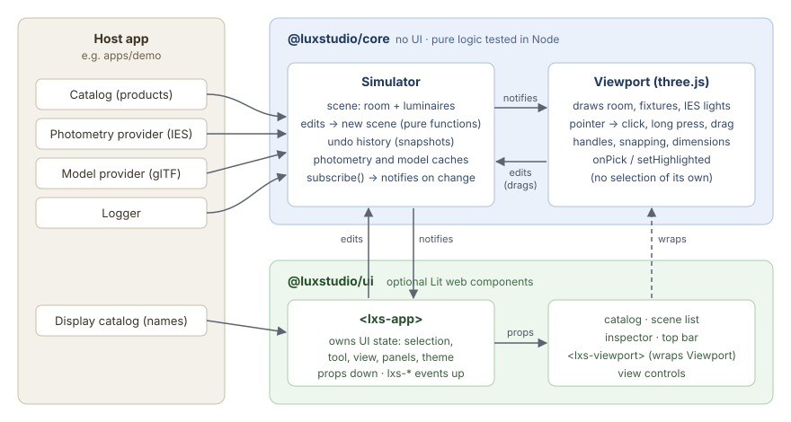

# How it works

This guide explains how Lux Studio is put together, then follows three
everyday actions through the code, step by step. Read it with the code open.
Each step links to where it happens. For the reasons behind each design, see
the [decision records](../decisions/README.md).

> **Watch it run:** open the demo with `?debug` in the URL and show the
> "Verbose" level in your browser console. The library logs each step
> described here (`[scene]`, `[photometry]`, `[drag]`…). A panel in the
> corner shows the frame rate, shadows and draw calls.

## The big picture

- **`@luxstudio/core`** has no UI. It holds the scene (a room plus luminaires),
  every edit and its undo history, IES photometry, and three.js rendering.
  Everything the host knows (products, IES files, 3D models, where logs go)
  is **injected** through small interfaces. Core never fetches anything itself
  ([ADR 0002](../decisions/0002-client-agnostic-library.md)).
- **`@luxstudio/ui`** is optional: Lit web components (`<lxs-app>` and its
  parts) built only on core's public API.
- **`apps/demo`** is a reference host: sample data, providers that fetch
  files, and the deployed page.

Dependencies only go one way, **demo → ui → core**, and ESLint enforces it.

## Core, piece by piece

### The scene is plain data

[`types.ts`](https://github.com/ewajs/lighting-simulator/blob/master/packages/core/src/types.ts)
defines the document: a {@link @luxstudio/core!Scene} has a
{@link @luxstudio/core!Room}, a list of {@link @luxstudio/core!Luminaire}s and
a list of {@link @luxstudio/core!Furniture}. These are readonly objects, metres
and SI units throughout. A luminaire refers to a
{@link @luxstudio/core!Product} by id; the host's catalog supplies the product.
Furniture is built in: each piece names one of 14 kinds, and
`furniture-kinds.ts` holds their usual sizes and finishes
([ADR 0047](../decisions/0047-furniture.md)).

Edits are **pure functions** that take a scene and return a new one:
`updateLuminaire`, `updateFurniture`, `removeItems`, `resizeRoom`,
`constrainPosition` and so on, in `luminaires.ts`, `furniture.ts`,
`scene-items.ts`, `room.ts` and `placement.ts`. They have no three.js and no
DOM, so they're unit-tested in Node.

Luminaires and furniture are plain objects, not classes with methods. A
scene is saved as JSON, and undo keeps old scenes, so nothing may change an
item in place. Where the two kinds behave alike, one function handles both:
`findItem`, `removeItems` and `duplicateItems` work by id, and ids are
unique across both lists. Where they differ, each kind has its own function
(`updateLuminaire`, `updateFurniture`) or its own rules, as in dragging below
([ADR 0048](../decisions/0048-one-set-of-edits-for-scene-items.md)).

### The Simulator owns the scene and its history

{@link @luxstudio/core!Simulator} is the one stateful object a host talks to.
Each edit method, such as `updateLuminaire`:

1. computes the next scene with the pure function,
2. records the previous scene for undo
   ([`history.ts`](https://github.com/ewajs/lighting-simulator/blob/master/packages/core/src/history.ts)),
3. replaces the current scene and calls every `subscribe` listener.

Undo keeps whole snapshots ([ADR 0016](../decisions/0016-undo-redo-in-core.md)).
That's cheap, because unchanged parts of the scene are shared between
snapshots. Edits that pass the same `mergeKey`, such as every pointer move of
one drag, become **one** undo step.

The Simulator also holds the host's providers. `simulator.photometry(id)` and
`simulator.model(id)` answer synchronously. On the first request they start
loading through the provider, then announce the result with `onPhotometry` and
`onModel`.

### The Viewport draws, and turns input into edits

{@link @luxstudio/core!Viewport} wraps a three.js `WebGPURenderer`, with a
WebGL 2 fallback. It subscribes to the Simulator and, on every change, syncs
its helpers in `render/`:

| File | Job |
|---|---|
| `RoomMeshes.ts` | the room's six surfaces |
| `LuminaireMeshes.ts` | one fixture per luminaire: model or placeholder, its light, outline, and the shadow budget |
| `fixtures.ts`, `FixtureModels.ts` | building a fixture from a glTF model or simple shapes |
| `IesLight.ts` | the light that follows an IES distribution in every direction |
| `PointerGestures.ts` | pointer events → click, long press, or drag |
| `Manipulator.ts` | the move and aim handles, and starting drags |
| `MoveHandle.ts`, `AimHandle.ts`, `SnapGuides.ts`, `DimensionLines.ts` | what the handles and guides look like |

The maths behind them stays pure and outside `render/`: `drag.ts`,
`move-handle.ts`, `aim.ts`, `snap.ts`, `measure.ts`, `placement.ts`.

The viewport keeps **no selection** of its own
([ADR 0019](../decisions/0019-viewport-host-owned-selection.md)). It reports
clicks (`onPick`) and outlines whatever the host passes to `setHighlighted`.

## The UI

{@link @luxstudio/ui!LxsApp | `<lxs-app>`} is the whole editor. Two rules
shape all the components:

- **Props down, events up** ([ADR 0021](../decisions/0021-props-down-events-up.md)).
  `<lxs-app>` owns UI state, such as the selection, the tool, the view and
  which panels are open. It passes that state down as properties. Children
  report what the user did as `lxs-*` events, such as `lxs-pick` or
  `lxs-select`.
- **Document edits go straight to the Simulator**
  ([ADR 0025](../decisions/0025-elements-edit-simulator-directly.md)). The
  inspector calls `simulator.updateLuminaire(...)` itself. Because
  `<lxs-app>` subscribes to the Simulator, every component then gets the new
  scene.

## Walkthrough 1: dragging a luminaire, from pointer to undo

1. **Pointer down.**
   [`PointerGestures`](https://github.com/ewajs/lighting-simulator/blob/master/packages/core/src/render/PointerGestures.ts)
   catches it on the canvas's container, before three's camera controls see it.
   It asks the Manipulator what's under the pointer (`targetAt`):
   - a handle arrow;
   - else part of the aim handle;
   - else a fixture, by ray hit or within 10 px on screen.

   - else a piece of furniture.

   On any of them, it switches the camera controls off, so the camera won't orbit.
2. **The pointer moves past the tap tolerance** (4 px with a mouse, 10 px for
   a finger). It becomes a drag. `Manipulator.startDrag` creates an
   [`ItemDrag`](https://github.com/ewajs/lighting-simulator/blob/master/packages/core/src/drag.ts)
   with the rules for what was grabbed: a luminaire slides over its mount
   surface, and a piece of furniture over the floor at the height it was
   grabbed (a picture over the walls). The drag remembers where every item
   in the group started, and the offset between the item and the point
   grabbed. It reports `onMoveStart`. `<lxs-viewport>` re-emits that as
   `lxs-move-start`, and `<lxs-app>` selects the item (`selectionForMove`).
   The steps below follow a luminaire; a piece goes through the same ones
   with its own rules.
3. **Each pointer move:**
   1. The Manipulator turns the pointer into a ray.
   2. It converts 8 px of alignment tolerance into metres at that distance.
   3. It calls `drag.moveTo(ray, snap)`. Inside:
      - `mountSurfaceHit` finds where the ray meets the surface this mount
        slides on ([`placement.ts`](https://github.com/ewajs/lighting-simulator/blob/master/packages/core/src/placement.ts));
      - the grab offset is added back;
      - `constrainPosition` keeps the luminaire on its mount;
      - `snapPosition` ([`snap.ts`](https://github.com/ewajs/lighting-simulator/blob/master/packages/core/src/snap.ts))
        lines it up or rounds it to the grid.
   4. Finally it calls `simulator.updateLuminaire(id, { position }, { mergeKey })`.
4. **The Simulator** applies the edit, merges it into the drag's single undo
   step, and notifies its subscribers:
   - `Viewport` moves the fixture (`LuminaireMeshes.sync`) and its handle
     (`Manipulator.refresh`).
   - `<lxs-app>` re-renders, so the inspector's X/Z fields update live.

   The Manipulator also draws the snap guides and wall dimensions. Each frame,
   the Viewport reports the dimension labels' screen positions through
   `onMeasure`, and `<lxs-viewport>` draws the labels.
5. **Pointer up.** The camera controls come back on. The guides and
   dimensions are cleared, and `[drag] Ended` is logged.
6. **⌘Z.** `<lxs-app>` maps the key with `shortcutAction`
   ([`shortcuts.ts`](https://github.com/ewajs/lighting-simulator/blob/master/packages/ui/src/shortcuts.ts))
   and calls `simulator.undo()`. The whole drag goes back in one step.

## Walkthrough 2: an IES file becomes light on the wall

1. **The fixture asks for its photometry.**
   [`LuminaireMeshes`](https://github.com/ewajs/lighting-simulator/blob/master/packages/core/src/render/LuminaireMeshes.ts)
   builds a fixture and calls `simulator.photometry(productId)`. The
   [`PhotometryCache`](https://github.com/ewajs/lighting-simulator/blob/master/packages/core/src/photometry/cache.ts)
   has nothing yet, so it calls the host's provider. The fixture is drawn
   meanwhile with a light estimated from the product's flux and beam angle.
2. **The host's provider fetches the file** and returns its text. The demo's
   is [`sample-photometry.ts`](https://github.com/ewajs/lighting-simulator/blob/master/apps/demo/src/sample-photometry.ts).
3. **The file is parsed and announced.** `parseIes`
   ([`photometry/ies.ts`](https://github.com/ewajs/lighting-simulator/blob/master/packages/core/src/photometry/ies.ts))
   turns it into a {@link @luxstudio/core!Photometry}: candela values by
   vertical and horizontal angle
   ([ADR 0033](../decisions/0033-ies-support-scope.md)). The cache logs a
   summary and calls `onPhotometry`, and the Viewport re-syncs.
4. **The fixture is rebuilt, because its photometry changed:**
   - `lightingProduct` takes flux and beam angle from the file.
   - `candelaGrid` ([`photometry/grid.ts`](https://github.com/ewajs/lighting-simulator/blob/master/packages/core/src/photometry/grid.ts))
     samples the whole sphere every 0.5° × 1° using `candelaAt`, which
     handles the file's symmetry.
   - `profileTexture` uploads that grid to the GPU.
   - The light becomes an `IesLight` with that texture.
5. **Every frame, on the GPU:** for each surface point, `IesLightNode`
   ([`render/IesLight.ts`](https://github.com/ewajs/lighting-simulator/blob/master/packages/core/src/render/IesLight.ts))
   turns the direction from the light into the luminaire's own angles
   ([ADR 0036](../decisions/0036-ies-light.md)). It looks up the intensity
   in the texture and scales the light by it. Aim and pan rotate that frame.
6. **Shadows:** only the 8 brightest lit luminaires cast shadows
   (`SHADOW_BUDGET`). Gaining a shadow is done in place. Losing one rebuilds
   the fixture, because switching shadows off in place breaks three's renderer.

## Walkthrough 3: a click becomes a selection

1. **Pointer down and up within the tap tolerance.** `PointerGestures` calls
   the Viewport's `pick`, which finds the luminaire or piece of furniture
   under the pointer (luminaires first) and calls every `onPick` listener with
   a {@link @luxstudio/core!PickEvent}: `{ target: { kind, id } }`, or a null
   target for empty space.
2. **`<lxs-viewport>` re-emits it** as `lxs-pick`.
3. **`<lxs-app>` decides what that means:** `selectionAfterPick`
   ([`selection.ts`](https://github.com/ewajs/lighting-simulator/blob/master/packages/ui/src/selection.ts)).
   A plain click selects one item. Shift or a long press toggles it, within
   one kind: luminaires and furniture are never selected together. A click on
   empty space clears the selection.
4. **The new selection flows down as properties:**
   - to `<lxs-viewport>`, which calls `setHighlighted`, so the outline and
     the move handle appear;
   - to the inspector, which shows the luminaire's (or the piece's) fields;
   - to the scene list, which marks its row.

## Where to start reading

In this order, each building on the last:

1. [`core/src/types.ts`](https://github.com/ewajs/lighting-simulator/blob/master/packages/core/src/types.ts): the data.
2. [`core/src/simulator.ts`](https://github.com/ewajs/lighting-simulator/blob/master/packages/core/src/simulator.ts) and [`history.ts`](https://github.com/ewajs/lighting-simulator/blob/master/packages/core/src/history.ts): edits and undo.
3. [`core/src/luminaires.ts`](https://github.com/ewajs/lighting-simulator/blob/master/packages/core/src/luminaires.ts) and [`placement.ts`](https://github.com/ewajs/lighting-simulator/blob/master/packages/core/src/placement.ts): what an edit does and where things may go.
4. [`core/src/render/Viewport.ts`](https://github.com/ewajs/lighting-simulator/blob/master/packages/core/src/render/Viewport.ts): how the scene gets drawn.
5. [`core/src/render/LuminaireMeshes.ts`](https://github.com/ewajs/lighting-simulator/blob/master/packages/core/src/render/LuminaireMeshes.ts) and [`fixtures.ts`](https://github.com/ewajs/lighting-simulator/blob/master/packages/core/src/render/fixtures.ts): fixtures and lights.
6. [`core/src/render/PointerGestures.ts`](https://github.com/ewajs/lighting-simulator/blob/master/packages/core/src/render/PointerGestures.ts) and [`Manipulator.ts`](https://github.com/ewajs/lighting-simulator/blob/master/packages/core/src/render/Manipulator.ts): input.
7. [`ui/src/lxs-app.ts`](https://github.com/ewajs/lighting-simulator/blob/master/packages/ui/src/lxs-app.ts): how the UI is assembled.
8. [`demo/src/main.ts`](https://github.com/ewajs/lighting-simulator/blob/master/apps/demo/src/main.ts): how a host wires everything.

Every pure module has a `*.test.ts` next to it. The tests are often the
quickest way to see what a function is for.
